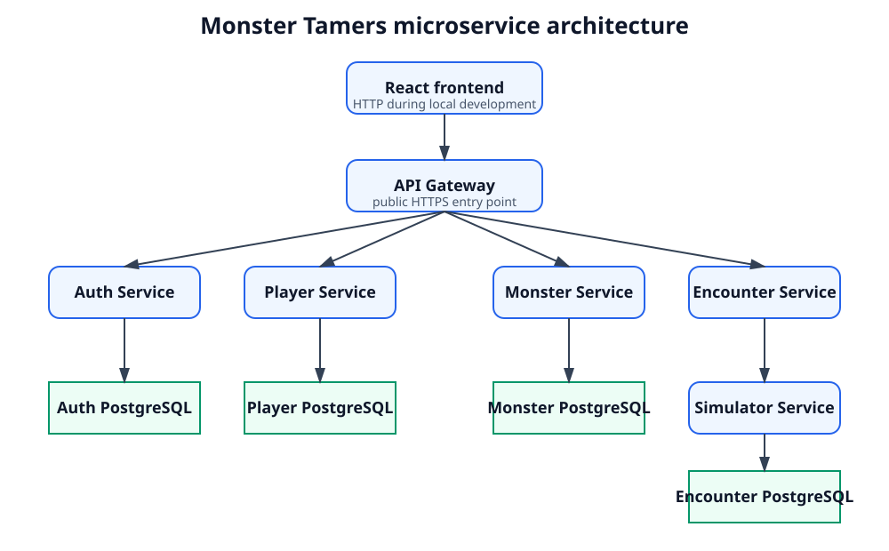

# Monster Tamers

Monster Tamers is a web application for collecting monsters, building teams,
exploring encounters and participating in battles.

## Group: OMB

| Name | Email |
|---|---|
| Olzhas Jalmukhambetov | o.jalmukhambetov@studenti.unipi.it |
| Martin Thomas Waxenberger | m.waxenberger@studenti.unipi.it |
| Benjamin Luis Spada | b.spada@studenti.unipi.it |

The project is organized as a monorepo with:

- TypeScript, React, Vite and Tailwind CSS frontend
- Java 21 and Spring Boot microservices
- PostgreSQL databases owned by individual services
- HTTPS communication through an API Gateway
- Docker Compose for the backend environment
- Maven, Vitest and ESLint verification
- GitHub Actions CI workflows

## Repository layout

```text
monster-tamers/
├── frontend/                 React frontend
├── backend/                  Spring Boot microservices
├── infrastructure/           TLS scripts and infrastructure documentation
├── docs/requirements/        Project requirements
├── docs/architecture/        Architecture documentation
├── .github/workflows/        CI workflows
└── README.md
```

## Architecture

The following diagram shows the planned microservice architecture. It includes
the Simulator Service and service-owned databases even when they are not
directly exposed by the Gateway.



Only the Gateway is exposed publicly by the backend Docker Compose stack.
Internal services and databases remain on the private Docker network.

## OpenAPI specifications

Committed OpenAPI snapshots are available under
[docs/openapi/](docs/openapi/). They document the Gateway and the service
endpoints that can currently be tested:

- [API Gateway](docs/openapi/gateway.yaml)
- [Auth Service](docs/openapi/auth.yaml)
- [Player Service](docs/openapi/player.yaml)
- [Monster Service](docs/openapi/monster.yaml)
- [Encounter Service](docs/openapi/encounter.yaml)
- [Simulator Service](docs/openapi/simulator.yaml)

When the backend is running, Springdoc also serves the generated specifications
at `/v3/api-docs` for each service. The Gateway exposes the routed documents
listed in [Verify HTTPS routing](#verify-https-routing). The committed files
are suitable for review without starting the application; the generated
documents are the runtime source of truth if an endpoint changes.

## Implementation status

Current progress can be seen in the associated GitHub issuesand the Project.
The status below follows the delivery structure and user-story numbering from
the `Acceptance-Criteria.pdf` used for this submission. The assessment refers
to the acceptance criteria, not only to whether a screen or backend class
exists:

- **Implemented** means the acceptance criterion is covered by the current
  implementation.
- **Partially implemented** means that a UI, backend path or mock exists, but
  the complete end-to-end criterion is not yet covered.
- **Not implemented** means that the required behaviour is not currently
  available.

The frontend uses a hybrid service layer. Authentication, monster collection,
teams, encounter lists/details and starting a battle call the real Gateway.
Player progress, stat upgrades, captured-monster rewards and battle history
still use mock or in-memory fallback data where the backend contract is not
finished.

### First delivery: 15.11.26

#### Account & Progress

- **US-01 - Create an account: Implemented.** Registration and confirmation
  are available through the frontend and Auth Service. Accounts are persisted
  with unique identifiers, and account creation triggers player/collection
  initialization.
- **US-02 - Log in: Implemented.** The login form calls the Auth Service,
  receives a JWT, stores the access token and protects the game routes.
- **US-03 - Have my progress available when I return: Partially
  implemented.** The profile page displays progress and the backend persists
  core domain data, but the frontend progress service currently uses fixtures
  rather than a complete authenticated progress endpoint.

#### Monster Collection

- **US-06 - Receive an initial set of monsters: Implemented.** The backend
  initializes an account's collection after player creation; the frontend can
  load the collection through the Gateway.
- **US-09 - View the monsters I own: Implemented.** The collection page lists
  the authenticated player's monsters using the real Monster Service.
- **US-10 - Browse all monsters available in the game: Not implemented.**
  There is currently no separate catalogue of all obtainable monsters; the
  existing endpoint lists the authenticated player's collection.
- **US-11 - View a monster's image and characteristics: Partially
  implemented.** The collection and detail pages show images, classes, stats,
  skills, traits and progression, but detail retrieval is not yet fully
  connected for every flow and uses fallback data in the hybrid frontend.
- **US-12 - Add an earned or captured monster to the collection: Partially
  implemented.** The mock battle flow can hatch an egg and add it to mock
  state. The real battle response does not yet persist and expose the reward
  through the integrated frontend/backend flow.

#### Teams

- **US-14 - Create a team from the collection: Implemented.** The team page
  loads and saves the authenticated player's team through the real Monster
  Service.
- **US-15 - Replace or remove monsters in the team: Implemented.** The team
  editor supports changing the selected monsters and persists the new team.
- **US-16 - Validate the selected team: Implemented.** Client-side validation
  gives immediate feedback, the start button is disabled for invalid teams,
  and the backend remains authoritative when a battle is requested.

#### Encounters

- **US-17 - View encounters and their characteristics: Implemented.** The
  encounter list and detail pages use the Encounter Service through the
  Gateway.
- **US-18 - Start an encounter with the selected team: Implemented.** A valid
  team can start a battle from the preparation page and the result page is
  opened after the battle response.
- **US-19 - Resolve an encounter according to the game rules: Implemented.**
  Encounter orchestration and the Simulator Service calculate victory or
  defeat, rounds and battle events.
- **US-20 - See encounter-result details: Implemented.** The battle-result
  page presents the outcome, participants, rounds and event report returned
  by the battle flow.

#### History & Integrity

- **US-23 - View previous encounters: Partially implemented.** A history page
  and filtering UI exist, but the real backend history endpoint is not yet
  integrated; the current page uses mock/in-memory history.
- **US-24 - View details of a previous encounter: Partially implemented.**
  History detail navigation and rendering exist, but persisted lookup after a
  new session is still missing from the backend/frontend integration.

#### Player Interface

- **US-28 - Perform the main game actions through a simple interface:
  Implemented.** The React application provides navigable pages and controls
  for authentication, collection, teams, encounters, battles, history and
  profile, with responsive layout and error/loading states.

### Final delivery: 15.12.26

#### Account & Progress

- **US-05 - Protect account data: Implemented.** Backend services validate JWT
  identity and scope account-owned queries and mutations to the authenticated
  account. Unauthorized requests are rejected and security behaviour is
  covered by backend tests.

#### History & Integrity

- **US-25 - Protect collection, history and progress from tampering or loss:
  Partially implemented.** Service-owned PostgreSQL persistence, ownership
  checks, validation and input/error handling are present. Complete
  persisted history/progress retrieval and verification after logout/login are
  not yet available through the frontend, and the current history fallback is
  not durable.

### Our requirements: 15.12.26

#### Monster Collection

- **US-30 - View monster classes: Partially implemented.** Class badges,
  descriptions and class-based information are shown on monster and profile
  screens, but there is no dedicated class page with the specified progression
  view.
- **US-31 - Level up a monster and choose a stat: Partially implemented.**
  The detail page supports choosing a stat after XP is gained in the mock
  battle flow. The real backend does not yet expose the corresponding
  persistent level-up/stat-upgrade operation.

#### Player Interface

- **US-29 - View player profile: Partially implemented.** A profile page
  displays name, collection, team, wins, losses and encounter progress, but
  progress data is still partly fixture-backed and is not yet fully supplied
  by the authenticated Player Service.

### Nice to have: 15.12.26

#### Account & Progress

- **US-04 - Choose or update player name and avatar: Not implemented.**
  The profile avatar is currently static and there is no persisted name/avatar
  editing flow.

#### Monster Collection

- **US-07 - Choose the first monster: Not implemented.** Initial monsters are
  generated automatically; there is no starting-monster selection screen.
- **US-08 - Choose a faction or starting affiliation: Not implemented.**
  Factions or equivalent affiliations are not modelled.
- **US-13 - Improve or customize monsters: Partially implemented.** The
  frontend mock supports XP, level-ups and stat allocation, but the complete
  class-specific skill-tree/customization flow is not implemented against the
  backend.

#### Encounters

- **US-21 - Leave or escape an encounter: Not implemented.** Battles currently
  resolve as an automated request; there is no active encounter state with an
  escape action.
- **US-22 - Choose attack or capture actions: Not implemented.** The current
  simulator generates battle events automatically and does not accept player
  attack/capture choices.

#### Social & Engagement

- **US-26 - Add and manage friends: Not implemented.** No social page or
  friend-management service exists.
- **US-27 - Challenge a friend: Not implemented.** Friend challenges and a
  multiplayer encounter mode are not implemented.

### Cross-cutting implementation status

This section assesses the remaining delivery-wide requirements separately from
the user stories above.

#### Architecture & repository

**Delivered**

- The backend is split into independently built Spring Boot services for
  Gateway, Auth, Player, Monster, Encounter and Simulator.
- Docker Compose builds the backend services and their PostgreSQL databases.
- Services expose REST endpoints, communicate over HTTPS in the Compose
  environment and keep service-owned persistent state.
- The Gateway is the public backend entry point. The frontend is configured to
  call the Gateway rather than internal services or databases.
- The repository contains a README with installation, build, run and testing
  instructions, and the frontend has its own standalone Dockerfile.
- Docker images run as the non-root `app` user, and the local TLS generation
  flow creates certificates for every service.

**Still missing or incomplete**

- The frontend container is not yet part of the backend Compose stack, so the
  complete architecture is not started by one Compose command.
- The frontend is not yet fully connected to the backend: progress, history,
  rewards and stat upgrades still have mock or in-memory fallbacks.
- Some business logic still exists in the frontend mock service for local
  simulation. The final client should delegate all authoritative rules and
  state changes to backend services.
- The frontend currently uses HTTP for its local Vite development address;
  HTTPS is used for backend service communication.

#### Documentation and required project artifacts

**Delivered**

- The README contains setup, build, run, testing, implementation-status and
  architecture information.
- OpenAPI specifications are committed for the Gateway and the backend
  services, and runtime Springdoc endpoints are available.
- The planned architecture is documented as an image.
- GitHub Actions workflow YAML files exist for backend, frontend and
  infrastructure verification.
- A committed project backlog with the final acceptance criteria and explicit
  story dependencies

**Still missing**

- A final report in PDF format.
- Bruno/Postman-compatible component or integration test collections exported
  as JSON.
- Locust performance-test files.
- The OpenAPI snapshots must be kept synchronized with the final backend
  endpoints as the missing contracts are implemented.

#### Core functionalities

**Delivered**

- Registration, confirmation-code login, JWT sessions and account-owned
  access checks are implemented.
- Initial monster collection creation, personal collection browsing, team
  preparation and team-rule validation are implemented.
- Encounter catalogue/detail views, backend battle orchestration, simulator
  results, victory/defeat outcomes and battle-result presentation are
  implemented.
- The frontend provides the prepare-encounter-result-progress flow and
  includes history and profile screens.
- Backend services, rather than a client-provided outcome, calculate the real
  battle result in the integrated flow.

**Still missing or incomplete**

- The all-monsters catalogue is not separate from the authenticated player's
  collection.
- Captured/earned-monster rewards, XP/stat upgrades, player progress and
  history are not yet consistently persisted and retrieved end to end.
- The frontend history and profile flows are therefore not yet reliable after
  logout and login or after restarting the application.
- The final frontend must remove mock business logic and use the backend as the
  authoritative source for rewards, progress and encounter history.

#### Testing

**Delivered**

- Component and integration-style tests exist for more than three internal
  services, including valid and invalid input/security cases.
- Backend Maven verification and frontend lint, test and build commands run in
  GitHub Actions.
- Infrastructure CI validates TLS material, Compose configuration, image
  building, non-root container execution and HTTPS stack startup.

**Still missing**

- No exported Bruno/Postman-compatible JSON collection currently verifies the
  complete architecture through the Gateway.
- No Locust performance tests currently target the Gateway and core loop.
- The final test evidence still needs explicit coverage of acceptance
  criteria, game-rule validation, ownership checks, encounter outcomes and
  progress persistence through the complete running stack.

#### Security

**Delivered**

- Backend containers run as a non-root user.
- Service certificates, truststores and HTTPS configuration are generated for
  the local Compose environment.
- JWT authentication and account-scoped authorization are implemented.
- Password input is accepted over the HTTPS backend flow, validated and
  stored using the Auth Service's password-hashing mechanism.
- Request validation, normalized email handling and structured error responses
  are covered by backend code and tests.

**Still missing or requiring verification**

- Full OAuth2 conformance is not implemented as a separate authorization
  server; the current solution provides JWT bearer authentication.
- Database encryption for sensitive data has not been demonstrated.
- Automated static analysis, dependency vulnerability scanning and Docker
  image scanning for high/critical vulnerabilities are not configured in the
  workflows.
- A final security review must verify sanitization, ownership isolation,
  malicious-input handling and the security-lab requirements against the
  complete deployed stack.

## APPLICATION SETUP

## Requirements

Install the following tools:

- Docker Desktop
- Git
- Java 21
- Node.js 24
- OpenSSL
- Java `keytool`
- PowerShell (on mac/linux especially)

Check the required tools:

```powershell
docker --version
git --version
java --version
node --version
npm --version
openssl version
keytool -version
pwsh --version
```

## Quick start

### 1. Clone the repository

```powershell
git clone <repository-url>
cd monster-tamers
```

### 2. Make OpenSSL available

On Windows, OpenSSL may be available through Git for Windows:

```powershell
$env:Path = "C:\Program Files\Git\usr\bin;$env:Path"

Remove-Item Env:OPENSSL_CONF -ErrorAction SilentlyContinue
Remove-Item Env:SSLEAY_CONF -ErrorAction SilentlyContinue

openssl version
```

### 3. Generate local TLS certificates

on Windows:
```powershell
.\infrastructure\tls\generate-local-certificates.ps1
```
On mac/linux:
```powershell
pwsh ./infrastructure/tls/generate-local-certificates.ps1
```

Choose a TLS password with:

- at least 12 characters
- printable ASCII characters only
- no spaces
- no `æ`, `ø`, `å` or other non-ASCII characters

The generated certificates, private keys, keystores and password file are
stored under:

```text
infrastructure/runtime/tls/
```

This directory is ignored by Git and must never be committed.

#### If certificates already exist and must be replaced:

on Windows:
```powershell
.\infrastructure\tls\generate-local-certificates.ps1 -Force
```
on mac/Linux:
```powershell
pwsh ./infrastructure/tls/generate-local-certificates.ps1 -Force
```

### 4. Trust the local development CA

#### Install only the public CA certificate:

on Windows:
```powershell
Import-Certificate `
  -FilePath infrastructure\runtime\tls\ca.crt `
  -CertStoreLocation Cert:\CurrentUser\Root
```
on mac:
```powershell
security add-trusted-cert -d -r trustRoot -k ~/Library/Keychains/login.keychain-db infrastructure/runtime/tls/ca.crt
```
on linux:
```powershell
sudo cp infrastructure/runtime/tls/ca.crt /usr/local/share/ca-certificates/monster-tamers-ca.crt
sudo update-ca-certificates
```

#### Confirm that the certificate was installed:

on Windows:
```powershell
Get-ChildItem Cert:\CurrentUser\Root |
  Where-Object {
    $_.Subject -eq "CN=Monster Tamers Local Development CA"
  } |
  Select-Object Subject, Thumbprint, NotAfter
```
on mac:
```powershell
security find-certificate -c "Monster Tamers Local Development CA" -p ~/Library/Keychains/login.keychain-db | openssl x509 -noout -subject -fingerprint -enddate
```

on Linux:
```powershell
openssl x509 -in /etc/ssl/certs/monster-tamers-ca.pem -noout -subject -fingerprint -enddate
```

#### Never install, share or commit the CA private key:

```text
infrastructure/runtime/tls/ca.key
```

#### If the certificates are regenerated, remove the old CA before importing the new one:

on Windows:
```powershell
Get-ChildItem Cert:\CurrentUser\Root |
  Where-Object {
    $_.Subject -eq "CN=Monster Tamers Local Development CA"
  } |
  Remove-Item

Import-Certificate `
  -FilePath infrastructure\runtime\tls\ca.crt `
  -CertStoreLocation Cert:\CurrentUser\Root
```

on mac:
```powershell
security delete-certificate -c "Monster Tamers Local Development CA" ~/Library/Keychains/login.keychain-db
security add-trusted-cert -d -r trustRoot -k ~/Library/Keychains/login.keychain-db infrastructure/runtime/tls/ca.crt
```

on Linux:
 - Step 1: regenerate certs
```powershell
sudo rm -f /usr/local/share/ca-certificates/monster-tamers-ca.crt
sudo update-ca-certificates --fresh
sudo cp infrastructure/runtime/tls/ca.crt /usr/local/share/ca-certificates/monster-tamers-ca.crt
sudo update-ca-certificates
```
 - Step 2: browser trust store for Chrome and Chromium
```powershell
sudo apt-get install -y libnss3-tools
certutil -d sql:$HOME/.pki/nssdb -A -t "C,," -n "Monster Tamers Local Development CA" -i infrastructure/runtime/tls/ca.crt
certutil -d sql:$HOME/.pki/nssdb -L | grep "Monster Tamers"
```

 - Step 2.1: if certs are regenerated, delete old browser entry before re-importing:
```powershell
certutil -d sql:$HOME/.pki/nssdb -D -n "Monster Tamers Local Development CA"
certutil -d sql:$HOME/.pki/nssdb -A -t "C,," -n "Monster Tamers Local Development CA" -i infrastructure/runtime/tls/ca.crt
```

### 5. Configure the backend

Create the local backend environment file:

```powershell
Copy-Item backend\.env.example backend\.env
```

on mac/Linux:
```powershell
cp backend/.env.example backend/.env
```

For local registration, make sure `backend/.env` contains:

```dotenv
MAIL_MODE=logging
```

The application does not require an email provider during local development.
Registration confirmation codes are written to the Auth Service logs.

Do not commit `backend/.env`.

### 6. Start the backend

Start all microservices and databases with Docker Compose:

```powershell
docker compose `
  --env-file backend/.env `
  -f backend/compose.yaml `
  up --build -d
```

Check the container status:

```powershell
docker compose `
  --env-file backend/.env `
  -f backend/compose.yaml `
  ps
```

The following application services should become healthy:

```text
gateway-service
auth-service
player-service
monster-service
encounter-service
simulator-service
```

The four PostgreSQL containers should also become healthy.

#### Test the HTTPS Gateway:

on Windows:
```powershell
Invoke-RestMethod https://localhost:8080/actuator/health
```

on mac/Linux:
```powershell
curl -fsSL https://localhost:8080/actuator/health
```

Expected result:

```text
UP
```

### 7. Configure the frontend

Create the local frontend environment file:

on Windows:
```powershell
@"
VITE_API_MODE=http
VITE_GATEWAY_BASE_URL=https://localhost:8080
VITE_API_BASE_URL=https://localhost:8080/api
VITE_MOCK_LATENCY_MS=0
"@ | Set-Content frontend\.env.local
```

on mac/Linux:
```powershell
cat << 'EOF' > frontend/.env.local
VITE_API_MODE=http
VITE_GATEWAY_BASE_URL=https://localhost:8080
VITE_API_BASE_URL=https://localhost:8080/api
VITE_MOCK_LATENCY_MS=0
EOF
```

Do not commit `frontend/.env.local`.

### 8. Start the frontend

```powershell
cd frontend
npm ci
npm run dev
```

Open the application:

```text
http://localhost:5173
```

Keep the frontend terminal running while using the application.

## Register an account

1. Open `http://localhost:5173`.
2. Select **Create account**.
3. Enter an email address and password.
4. Open another PowerShell terminal.
5. Follow the Auth Service logs:

```powershell
docker compose `
  --env-file backend/.env `
  -f backend/compose.yaml `
  logs -f auth-service
```

6. Find the logged registration confirmation code.
7. Enter the code on the confirmation page.
8. Log in with the registered account.

**Disclaimer**: A self-test on Mac could not sufficiently connect to the backend server to register or to login. Needless to say, we will look into this.

Press `Ctrl+C` to stop following the logs. This does not stop the containers.

Email delivery is not required for the current local setup because
`MAIL_MODE=logging` writes the code directly to the Auth Service logs.

## Local addresses

| Component | Address |
|---|---|
| Frontend | `http://localhost:5173` |
| HTTPS Gateway | `https://localhost:8080` |
| API base URL | `https://localhost:8080/api` |
| Gateway health | `https://localhost:8080/actuator/health` |
| Swagger UI | `https://localhost:8080/swagger-ui.html` |

Internal microservices and PostgreSQL databases are not published to the host.

## Stop the application

Stop the frontend by pressing `Ctrl+C` in the frontend terminal.

Stop the backend while preserving database data:

```powershell
docker compose `
  --env-file backend/.env `
  -f backend/compose.yaml `
  down
```

Remove containers and database volumes:

```powershell
docker compose `
  --env-file backend/.env `
  -f backend/compose.yaml `
  down -v
```

The second command permanently removes local database data.

## Run tests

### Backend

```powershell
cd backend
.\mvnw.cmd clean verify
```

for mac/Linux:
```powershell
cd backend
./mvnw clean verify
```

### Frontend

```powershell
cd frontend
npm test
npm run lint
npm run build
```

The backend tests may use Testcontainers, so Docker Desktop must be running.
The frontend tests use the local mock data and do not require the backend.

## Verify HTTPS routing

#### Check the Gateway:

For Windows:
```powershell
Invoke-RestMethod https://localhost:8080/actuator/health
```
for mac/Linux:
```powershell
curl -fsSL https://localhost:8080/actuator/health
```

#### Check the service documentation through the Gateway:

For Windows:
```powershell
Invoke-RestMethod https://localhost:8080/docs/auth/v3/api-docs
Invoke-RestMethod https://localhost:8080/docs/players/v3/api-docs
Invoke-RestMethod https://localhost:8080/docs/monsters/v3/api-docs
Invoke-RestMethod https://localhost:8080/docs/encounters/v3/api-docs
```

for mac/Linux:
```powershell
curl -fsSL https://localhost:8080/docs/auth/v3/api-docs
curl -fsSL https://localhost:8080/docs/players/v3/api-docs
curl -fsSL https://localhost:8080/docs/monsters/v3/api-docs
curl -fsSL https://localhost:8080/docs/encounters/v3/api-docs
```

#### Plain HTTP should be rejected:

For Windows:
```powershell
try {
    Invoke-WebRequest http://localhost:8080/actuator/health
} catch {
    $_.Exception.Message
}
```

for mac/Linux:
```powershell
curl -fsS http://localhost:8080/actuator/health || echo "Plain HTTP rejected as expected"
```

## Security

Never commit:

- `backend/.env`
- `frontend/.env.local`
- `infrastructure/runtime/tls/`
- CA private keys
- service private keys
- PKCS#12 files
- truststores
- TLS passwords
- SMTP credentials

Each developer and reviewer should generate separate local TLS material.

If a credential is displayed in terminal output, chat, source control or a pull
request, revoke it and generate a replacement immediately.

## Frontend Docker status

All backend microservices and databases run through Docker Compose.

The frontend currently runs through the Vite development server:

```powershell
cd frontend
npm run dev
```

The final delivery requires the complete application to run through Docker.
The production frontend build must also be served from a frontend container,
for example through Nginx, and added to `backend/compose.yaml`.

Until that integration is implemented, follow the frontend startup instructions
in this README.

## Additional information

- The default local environment is intended for development and review, not
  production deployment.
- TLS material, environment files and credentials are deliberately generated
  or configured locally and are excluded from Git.
- The frontend's mock-data boundary is documented in
  [frontend/README.md](frontend/README.md); replacing those adapters with
  Gateway calls is the next major integration step.
- More backend and infrastructure details are available in
  [backend/README.md](backend/README.md) and
  [infrastructure/README.md](infrastructure/README.md).

## More documentation

- backend/README.md
- infrastructure/README.md
- [Contribution guidelines](CONTRIBUTING.md)
- docs/requirements/
- docs/architecture/
