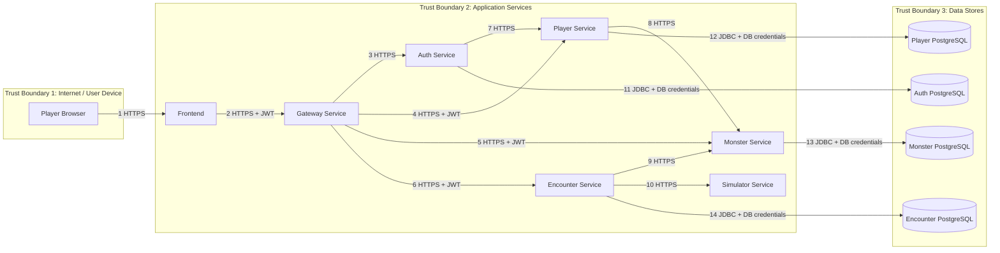
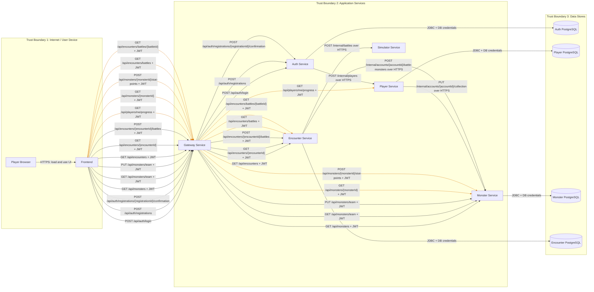

# Threat Model – Monster Tamers

## Assumptions checked against the current system

- Frontend runs in a browser and talks only to the API Gateway.
- Gateway Service is the single public backend entry point.
- All backend service-to-service communication uses HTTPS/TLS with the trust stores configured in `compose.yaml`.
- Auth Service owns registration, confirmation and login.
- Each business service owns its own database.
- Auth Service calls Player Service.
- Player Service calls Monster Service.
- Encounter Service calls Monster Service and Simulator Service.

## Data Flow Diagram (DFD)

## Data Flow Review

| # | Source | Destination | Transport | Purpose |
|---|---|---|---|---|
| 1 | User | Frontend | HTTPS | Load UI |
| 2 | Frontend | Gateway | HTTPS + JWT | API requests |
| 3 | Gateway | Auth Service | HTTPS/TLS | Login, registration, confirmation |
| 4 | Gateway | Player Service | HTTPS/TLS + JWT | Player profile |
| 5 | Gateway | Monster Service | HTTPS/TLS + JWT | Collection and teams |
| 6 | Gateway | Encounter Service | HTTPS/TLS + JWT | Encounters and battles |
| 7 | Auth Service | Player Service | HTTPS/TLS | Create player after registration |
| 8 | Player Service | Monster Service | HTTPS/TLS | Initialize collection |
| 9 | Encounter Service | Monster Service | HTTPS/TLS | Load battle monsters |
| 10 | Encounter Service | Simulator Service | HTTPS/TLS | Execute battle simulation |
| 11 | Auth Service | Auth PostgreSQL | JDBC | Accounts and credentials |
| 12 | Player Service | Player PostgreSQL | JDBC | Player profile data |
| 13 | Monster Service | Monster PostgreSQL | JDBC | Monsters and teams |
| 14 | Encounter Service | Encounter PostgreSQL | JDBC | Encounter progress and battle history |

## Detailed Data Flow Diagram: Individual API Calls

This version expands the aggregated flows above. Each currently active HTTP
operation is represented by its own arrow. Operations that remain mock-backed
in the frontend are not included.

## Detailed Data Flow Diagram: Individual API Calls

**Legend:**

- Solid arrow: implemented and active in frontend HTTP mode.
- Orange dashed arrow: HTTP adapter/backend operation exists, but the frontend currently uses mock or in-memory behavior.
- Authentication operations are public.
- Public game API operations require a JWT.
- Internal service calls bypass the Gateway and use the private TLS network.

The authentication endpoints are public. The Monster and Encounter API calls
carry a JWT. Internal calls do not pass through the Gateway and rely on the
private service network and configured TLS trust.

## What the AI Draft Is Likely to Miss MUST BE REMOVED

1. The three trust boundaries.
2. The four separate PostgreSQL databases.
3. Auth Service → Player Service communication.
4. Player Service → Monster Service communication.
5. Encounter Service → Simulator Service communication.
6. TLS on internal service-to-service traffic.
7. The frontend communicating through the Gateway rather than directly with backend services.

## Assets

| ID | Asset |
|----|--------|
| A1 | User accounts |
| A2 | User credentials |
| A3 | JWT secret |
| A4 | JWT access tokens |
| A5 | Player profiles |
| A6 | Monster collections |
| A7 | Team configurations |
| A8 | Encounter progress |
| A9 | Battle history |
| A10 | PostgreSQL databases |
| A11 | TLS certificates and keystores |
| A12 | Trust stores |
| A13 | Registration confirmation codes |
| A14 | Environment-variable secrets |

## Attack Surfaces

| ID | Attack Surface |
|----|----------------|
| S1 | Frontend exposed to browsers |
| S2 | Gateway HTTPS endpoints |
| S3 | Registration endpoints |
| S4 | Login endpoints |
| S5 | JWT validation |
| S6 | Player Service APIs |
| S7 | Monster Service APIs |
| S8 | Encounter Service APIs |
| S9 | Internal service-to-service APIs |
| S10 | Simulator internal endpoint |
| S11 | PostgreSQL instances |
| S12 | TLS certificate handling |
| S13 | Docker secrets and mounted credentials |
