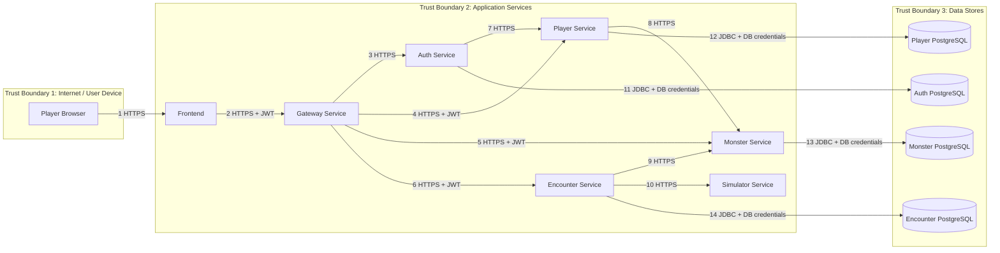
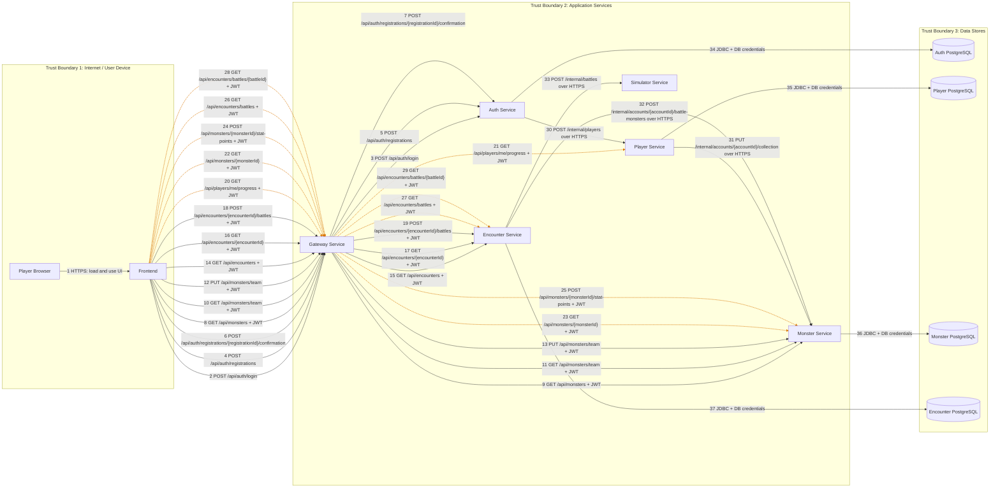

# Threat Model – Monster Tamers

## Assumptions checked against the current system

- Frontend runs in a browser and talks only to the API Gateway.
- Gateway Service is the single public backend entry point.
- All backend service-to-service communication uses HTTPS/TLS with the trust stores configured in `compose.yaml`.
- Auth Service owns registration, confirmation and login.
- Each business service owns its own database.
- Auth Service calls Player Service.
- Player Service calls Monster Service.
- Encounter Service calls Monster Service and Simulator Service.

## Data Flow Diagram (DFD)

## Data Flow Review

| # | Source | Destination | Transport | Purpose |
|---|---|---|---|---|
| 1 | User | Frontend | HTTPS | Load UI |
| 2 | Frontend | Gateway | HTTPS + JWT | API requests |
| 3 | Gateway | Auth Service | HTTPS/TLS | Login, registration, confirmation |
| 4 | Gateway | Player Service | HTTPS/TLS + JWT | Player profile |
| 5 | Gateway | Monster Service | HTTPS/TLS + JWT | Collection and teams |
| 6 | Gateway | Encounter Service | HTTPS/TLS + JWT | Encounters and battles |
| 7 | Auth Service | Player Service | HTTPS/TLS | Create player after registration |
| 8 | Player Service | Monster Service | HTTPS/TLS | Initialize collection |
| 9 | Encounter Service | Monster Service | HTTPS/TLS | Load battle monsters |
| 10 | Encounter Service | Simulator Service | HTTPS/TLS | Execute battle simulation |
| 11 | Auth Service | Auth PostgreSQL | JDBC | Accounts and credentials |
| 12 | Player Service | Player PostgreSQL | JDBC | Player profile data |
| 13 | Monster Service | Monster PostgreSQL | JDBC | Monsters and teams |
| 14 | Encounter Service | Encounter PostgreSQL | JDBC | Encounter progress and battle history |

## Detailed Data Flow Diagram: Individual API Calls

This version expands the aggregated flows above. Each currently active HTTP
operation is represented by its own arrow. Operations that remain mock-backed
in the frontend are depicted in orange.

**Legend:**

- Solid arrow: implemented and active in frontend HTTP mode.
- Orange dashed arrow: HTTP adapter/backend operation exists, but the frontend currently uses mock or in-memory behavior.
- Authentication operations are public.
- Public game API operations require a JWT.
- Internal service calls bypass the Gateway and use the private TLS network.

The authentication endpoints are public. The Monster and Encounter API calls
carry a JWT. Internal calls do not pass through the Gateway and rely on the
private service network and configured TLS trust.

## Detailed Data Flow Review

| # | Source | Destination | Transport | Endpoint | Purpose |
|---|---|---|---|---|---|
| 1 | User | Frontend | HTTPS | — | Load and use UI |
| 2 | Frontend | Gateway Service | HTTPS | `POST /api/auth/login` | Submit user login credentials |
| 3 | Gateway Service | Auth Service | HTTPS/TLS | `POST /api/auth/login` | Authenticate user and issue JWT |
| 4 | Frontend | Gateway Service | HTTPS | `POST /api/auth/registrations` | Submit new user registration |
| 5 | Gateway Service | Auth Service | HTTPS/TLS | `POST /api/auth/registrations` | Create pending user account |
| 6 | Frontend | Gateway Service | HTTPS | `POST /api/auth/registrations/{registrationId}/confirmation` | Submit registration confirmation |
| 7 | Gateway Service | Auth Service | HTTPS/TLS | `POST /api/auth/registrations/{registrationId}/confirmation` | Confirm and activate user account |
| 8 | Frontend | Gateway Service | HTTPS + JWT | `GET /api/monsters` | Request player's monster collection |
| 9 | Gateway Service | Monster Service | HTTPS/TLS + JWT | `GET /api/monsters` | Retrieve player's monster collection |
| 10 | Frontend | Gateway Service | HTTPS + JWT | `GET /api/monsters/team` | Request active monster team |
| 11 | Gateway Service | Monster Service | HTTPS/TLS + JWT | `GET /api/monsters/team` | Retrieve active monster team |
| 12 | Frontend | Gateway Service | HTTPS + JWT | `PUT /api/monsters/team` | Submit updated monster team |
| 13 | Gateway Service | Monster Service | HTTPS/TLS + JWT | `PUT /api/monsters/team` | Update active monster team |
| 14 | Frontend | Gateway Service | HTTPS + JWT | `GET /api/encounters` | Request available encounters |
| 15 | Gateway Service | Encounter Service | HTTPS/TLS + JWT | `GET /api/encounters` | Retrieve available encounters |
| 16 | Frontend | Gateway Service | HTTPS + JWT | `GET /api/encounters/{encounterId}` | Request specific encounter details |
| 17 | Gateway Service | Encounter Service | HTTPS/TLS + JWT | `GET /api/encounters/{encounterId}` | Retrieve specific encounter details |
| 18 | Frontend | Gateway Service | HTTPS + JWT | `POST /api/encounters/{encounterId}/battles` | Request battle execution in encounter |
| 19 | Gateway Service | Encounter Service | HTTPS/TLS + JWT | `POST /api/encounters/{encounterId}/battles` | Initiate and execute encounter battle |
| 20 | Frontend | Gateway Service | HTTPS + JWT | `GET /api/players/me/progress` | Request player progress (mock-backed in frontend) |
| 21 | Gateway Service | Player Service | HTTPS/TLS + JWT | `GET /api/players/me/progress` | Retrieve player progress (mock-backed in frontend) |
| 22 | Frontend | Gateway Service | HTTPS + JWT | `GET /api/monsters/{monsterId}` | Request specific monster details (mock-backed in frontend) |
| 23 | Gateway Service | Monster Service | HTTPS/TLS + JWT | `GET /api/monsters/{monsterId}` | Retrieve specific monster details (mock-backed in frontend) |
| 24 | Frontend | Gateway Service | HTTPS + JWT | `POST /api/monsters/{monsterId}/stat-points` | Submit monster stat-point allocation (mock-backed in frontend) |
| 25 | Gateway Service | Monster Service | HTTPS/TLS + JWT | `POST /api/monsters/{monsterId}/stat-points` | Allocate monster stat points (mock-backed in frontend) |
| 26 | Frontend | Gateway Service | HTTPS + JWT | `GET /api/encounters/battles` | Request battle history list (mock-backed in frontend) |
| 27 | Gateway Service | Encounter Service | HTTPS/TLS + JWT | `GET /api/encounters/battles` | Retrieve battle history list (mock-backed in frontend) |
| 28 | Frontend | Gateway Service | HTTPS + JWT | `GET /api/encounters/battles/{battleId}` | Request specific battle details (mock-backed in frontend) |
| 29 | Gateway Service | Encounter Service | HTTPS/TLS + JWT | `GET /api/encounters/battles/{battleId}` | Retrieve specific battle details (mock-backed in frontend) |
| 30 | Auth Service | Player Service | HTTPS/TLS | `POST /internal/players` | Create player profile after registration |
| 31 | Player Service | Monster Service | HTTPS/TLS | `PUT /internal/accounts/{accountId}/collection` | Initialize starter monster collection |
| 32 | Encounter Service | Monster Service | HTTPS/TLS | `POST /internal/accounts/{accountId}/battle-monsters` | Load battle monsters for encounter |
| 33 | Encounter Service | Simulator Service | HTTPS/TLS | `POST /internal/battles` | Execute battle simulation |
| 34 | Auth Service | Auth PostgreSQL | JDBC | — | Read/write accounts and credentials |
| 35 | Player Service | Player PostgreSQL | JDBC | — | Read/write player profile data |
| 36 | Monster Service | Monster PostgreSQL | JDBC | — | Read/write monsters and teams |
| 37 | Encounter Service | Encounter PostgreSQL | JDBC | — | Read/write encounter progress and battle history |

## Trust Boundaries

| ID | Trust Boundary |
|----|----------------|
| TB1 | Internet / User Device ↔ Frontend and Gateway |
| TB2 | Application Services ↔ Databases |
| TB3 | Service-to-service communication over authenticated TLS channels |
| TB4 | Source repository and CI/CD pipeline ↔ deployed runtime environment |

## Assets

| ID | Asset |
|----|--------|
| A1 | User accounts |
| A2 | User credentials |
| A3 | JWT secret |
| A4 | JWT access tokens |
| A5 | Player profiles |
| A6 | Monster collections |
| A7 | Team configurations |
| A8 | Encounter progress |
| A9 | Battle history |
| A10 | PostgreSQL databases |
| A11 | TLS certificates and keystores |
| A12 | Trust stores |
| A13 | Registration confirmation codes |
| A14 | Environment-variable secrets |
| A15 | Service availability and uptime |
| A16 | Audit logs and security-relevant event records |

## Attack Surfaces

| ID | Attack Surface |
|----|----------------|
| S1 | Frontend exposed to browsers |
| S2 | Gateway HTTPS endpoints |
| S3 | Registration endpoints |
| S4 | Login endpoints |
| S5 | JWT validation |
| S6 | Player Service APIs |
| S7 | Monster Service APIs |
| S8 | Encounter Service APIs |
| S9 | Internal service-to-service APIs |
| S10 | Simulator internal endpoint |
| S11 | PostgreSQL instances |
| S12 | TLS certificate handling |
| S13 | Docker secrets and mounted credentials |
| S14 | GitHub repository and source control |
| S15 | GitHub Actions CI/CD workflows |
| S16 | Third-party Maven and npm dependencies |
| S17 | Container images and Docker build artifacts |
